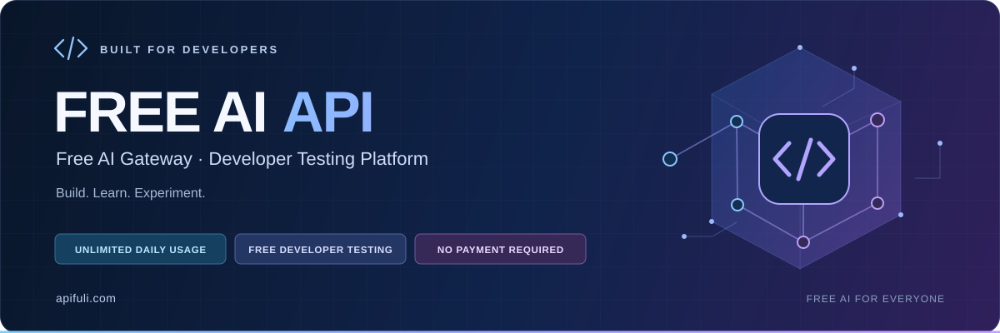

# 🚀 Free AI API — 公益 AI 中转站 & 开发者免费测试平台

  

[English](README_EN.md)

**项目方提供的福利说明：完全免费 | 每日不限量 | 注册即送 50 元 | 0.01 倍率 | 无充值入口**

官方网站：[https://apifuli.com](https://apifuli.com)

> **站长已确认运营规则：**注册赠送 50 元额度、0.01 计费倍率、每日不限量使用、每日签到赠送额度、全站无充值入口，并每日在 QQ 群 1131913173 免费发放邀请码。首页所说的“按量计费”指从赠送额度中扣减，不代表需要充值。公开设置显示邀请码注册已开启、支付和订阅购买入口已关闭；API 地址与文档尚未公开，相关教程不会猜写。官网尚未公开隐私政策或数据处理说明；正式公开本仓库前，需根据实际数据流程补齐并复核隐私披露。

Free AI API 是面向 AI 爱好者、学生和开发者的公益 AI API 网关及开发者测试平台项目介绍。本站目前未公开足够的 API 接入资料，因而本文不承诺具体 API 协议、兼容客户端、模型名称或可用性。请以官网公开信息为准。

## 公益福利

以下运营规则已由站长确认：

- 注册即送 50 元 API 额度。
- 每日不限量免费使用。
- 全站 0.01 超低倍率。
- 每日签到免费领取额度。
- 全站完全免费，无任何充值入口。
- 支持开发者日常编程及项目测试。
- 面向 AI 爱好者、学生及开发者开放。

首页的按量计费是对赠送额度的扣减说明，不代表用户需要充值。官网公开设置中的支付和订阅购买入口均为关闭状态。

## 免费邀请码领取

为了防止恶意注册、机器人刷量及公益资源滥用，本站采用邀请码注册机制。邀请码每日在官方 QQ 群免费发放；无需付费、无需 Star、无需转发。

- 项目方提供的信息：每日在 QQ 群免费发放邀请码。
- 无需付费、无需 Star、无需转发。
- 支持开发者技术交流及使用反馈。

官方 QQ 交流群：1131913173

官方网站：[https://apifuli.com](https://apifuli.com)

## 适用场景

项目目标涵盖以下开发及学习场景。请先依据已发布的接入资料确认服务是否适用于你的客户端和工作流。

- AI 编程与辅助开发
- AI Agent 智能体开发
- 大模型 API 接口调试
- AI 应用开发与测试
- 开源项目开发
- 自动化工作流
- 大模型学习与研究
- 日常 AI 对话

## 快速开始

1. 加入 QQ 群 1131913173。
2. 免费领取注册邀请码。
3. 访问 [https://apifuli.com](https://apifuli.com) 注册账号。
4. 领取 50 元免费额度。
5. 创建专属 API Key。
6. 按平台公布的实际 API 地址和协议配置 AI 客户端。

API Base URL、可用模型和客户端配置尚未公开确认，因此不在这里提供猜测的端点、模型名或教程。待平台发布实际接入文档后再补充。

## 公益运营理念

项目方提出的运营目标是：不出售额度、不开放充值入口、不设置每日使用总量上限，致力于打造开放、友好、可持续的公益 AI 开发者测试平台。

让开发者专注于技术、学习与创新。

实际线上配置应与上述已确认规则保持一致，并以服务条款及平台运行情况为准。

## 使用说明

- 禁止恶意刷量、批量注册、接口滥用及倒卖公益资源。
- 接口并发、模型可用性以平台实际运行情况为准。
- 请勿在公开 Issues 中提交 API Key、账号密码、私有对话、个人资料或日志；提交 Bug 前先清理敏感信息。
- 请求日志、原始对话和工具调用记录的数据处理规则将在隐私政策中如实说明；政策公开前请勿发送敏感内容。

## 支持项目

如果本项目对你的学习或开发有所帮助，欢迎自愿 Star 收藏。无需 Star 即可申请邀请码。

**Free AI for Everyone — 让每一位开发者都能免费使用 AI。**

## 项目范围与独立性

本仓库是第三方公益服务的介绍与开发者资料，不隶属于 OpenAI、Anthropic、Google 或其他模型与工具供应商，也不代表其官方项目。只有在官网公开信息可以佐证时，才会在文档中列出服务协议、模型或客户端兼容性。
